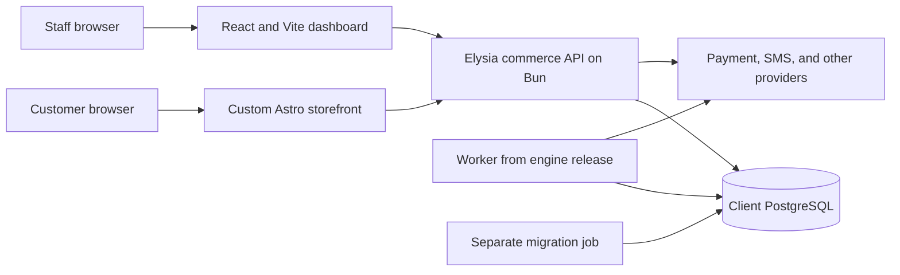

# System architecture

The [accepted baseline](decision-register.md#accepted-baseline) fixes the stack and system shape. Exact modules, transactions, topology, and packaging below are PROPOSED. M0a creates documentation, not a runnable application.

## System shape

One reusable commerce engine supports independently deployed clients. Each deployment has its own PostgreSQL database, secrets, media, configuration, and operational responsibility. No shared multi-tenant database is proposed.

A client's custom Astro storefront consumes the engine's OpenAPI contract. Optional React islands supply interactive behavior. The shared React + Vite dashboard uses administrative endpoints. The engine runs on Bun with Elysia and TypeBox. Better Auth handles enabled identity methods. Drizzle handles persistence.

The diagram shows one client deployment. Its arrows do not prescribe an approved hostname layout. [Client deployments](client-deployments.md) discusses that choice.

## Checkout and payment flow

The proposed checkout command validates ownership and a server-calculated quote. It freezes line prices, quantities, discounts, taxes, shipping, currency, and the pricing policy version. It reserves all required stock atomically and records the order's commercial snapshot.

Before an external operation, the engine persists the attempt and operation intent. It calls the gateway outside the database transaction. A browser callback requests reconciliation. A missing callback, timeout, or expired stock hold does not establish nonpayment.

The payment module preserves financial evidence. The order module separately determines fulfillment eligibility. In a final local transaction, confirmation selects an accepted payment and consumes a valid reservation or reacquires stock under the approved policy. Inventory allocation, order progression, and resulting outbox records commit together.

If stock cannot be allocated after payment, the order enters a visible exception and financial recovery remains owed. A second successful payment is retained as evidence and creates an overpayment obligation. It does not create another fulfillment.

## Ownership and effects

[Module boundaries](module-boundaries.md) defines the proposed owners. Checkout coordinates public module operations within one transaction when required. Modules must not independently commit parts of an operation promised to be atomic.

The outbox provides durable eventual effects after local commits. It does not coordinate stock or payment correctness through eventual notifications. External success followed by a local crash still needs provider idempotency or reconciliation.

## Scope boundaries

Storefronts own presentation, content, and interaction design. The engine owns pricing, stock decisions, payment interpretation, authorization, and order transitions. The thin client owns transport conveniences.

No theme engine or runtime plugin framework is introduced. [Build-time customization](../adr/BC-ADR-009-client-customization.md) remains a proposal. [Implementation gates](implementation-gates.md) control when any of these flows may be implemented.
